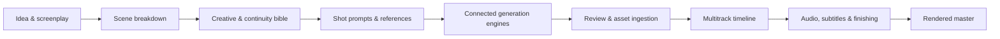
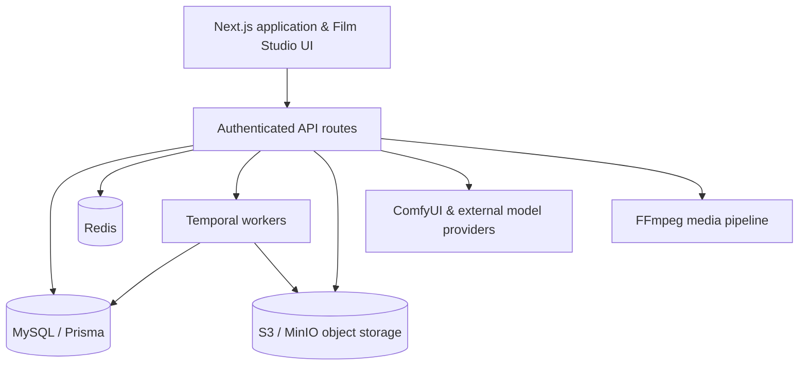

<div align="center">
  

  <h1>filmAI Studio</h1>
  <p><strong>From first idea to final cut — one connected AI film-production workspace.</strong></p>
  <p>
    <a href="docs/INSTALL.md">Installation</a> ·
    <a href="#production-workflow">Production workflow</a> ·
    <a href="#generation-engines">Generation engines</a> ·
    <a href="docs/film-studio/production-pipeline-v1.4.md">Pipeline notes</a> ·
    <a href="CHANGELOG.md">Changelog</a>
  </p>
  <p>
    
    
    
    
    
    
  </p>
</div>

---

**filmAI Studio** is a production-oriented creative environment for developing screenplays, planning shots, maintaining visual continuity, generating media through connected model workflows, and assembling finished video. It brings a project workspace and a dedicated film studio together without pretending that model runtimes, weights, or provider credentials are bundled for free.

> **What it is:** an extensible filmmaking workspace and orchestration layer. **What it is not:** a bundled frontier video model or a one-click replacement for every professional editing, VFX, and colour-grading suite.

## Contents

- [Highlights](#highlights)
- [Production workflow](#production-workflow)
- [Generation engines](#generation-engines)
- [Architecture](#architecture)
- [Quick start](#quick-start)
- [Verification](#verification)
- [Repository map](#repository-map)
- [Application route map](docs/ROUTE-MAP.md)
- [Security and responsible use](#security-and-responsible-use)
- [Contributing](#contributing)
- [Licensing](#licensing)

## Highlights

| Workspace | What you can do |
| --- | --- |
| **Screenplay & AI Story Director** | Draft or import scripts; use a configured text model for screenplay writing, story treatments, director vision, character arcs and production planning. |
| **Storyboard & shot planning** | Break scripts into scenes, generate structured shot plans with framing, lenses, camera movement, duration and prompts, and export production handoff data. |
| **Multi-model generation** | Discover compatible ComfyUI model families and submit configured video, image, voice, music, sound-effects and lip-sync workflows; use provider-specific model nodes and custom workflows. |
| **Professional editor** | Arrange frame-based clips across video, overlay, audio, title and effect tracks; use transitions, per-clip grading, VFX and revision-aware persistence. |
| **Finishing & assembly** | Composite multitrack picture, generate score, dialogue and sound design, then mix dialogue/music/effects with automatic ducking, add subtitles and LUTs, and render segmented H.264 masters up to 4K UHD. |
| **Asset library** | Ingest generated outputs into managed storage with metadata and SHA-256 checksums. |
| **Free Video Lab** | Turn up to 30 still images into a local browser-generated WebM motion video with pan/zoom movement. |
| **Project workspace** | Keep creative work, project resources, assistant interactions, and production assets connected. |

### Production-minded capabilities

- **AI story direction:** model-backed screenplay drafting, story treatments, director vision, character arcs, structured shot breakdowns, and production-plan generation.
- **Sound department:** dedicated music, dialogue/voice, sound-effects/Foley and lip-sync workflow prompts, with sequential pipeline submission for configured audio tasks.
- **Automated production:** submit draft scenes and configured audio tasks in sequence, pause safely on errors, and track durable jobs before editorial review.
- **Continuity context:** reusable character, voice, location, and visual-style bibles; scene notes; and optional approved reference assets.
- **Frame-accurate editing data:** integer-frame clip positions, source trims, supported transitions, and multiple track types.
- **Resilient rendering:** persisted render jobs, bounded segmented output, checkpoint-aware retries, and permanent master ingestion.
- **GPU-aware queueing:** conservative generation back-pressure using available ComfyUI telemetry, with a safe fallback when telemetry is unavailable.
- **Flexible model connectivity:** Account-configured text models for AI direction plus ComfyUI workflow discovery for Wan, LTX, Hunyuan, audio/speech, lip-sync and upscaling families. Media-model choice is determined by the imported workflow and installed nodes.
- **Local-first utility:** the Free Video Lab creates motion from user-selected stills in the browser; it does not call a paid AI model.

## Production workflow



1. Create a project and write or import a screenplay.
2. Break it into scenes and refine the visual direction for each shot.
3. Define cast, location, voice, and visual continuity constraints.
4. Configure compatible generation workflows and submit scene or audio jobs.
5. Review outputs and save approved media to the production asset library.
6. Arrange and trim clips on the timeline, then apply supported finishing controls.
7. Use the sequential scene pipeline to submit draft scenes, then assemble approved picture, dialogue, score and effects on the multitrack timeline.
8. Render a checkpointed H.264 MP4 master up to 4K UHD and optionally generate or burn in subtitles.

## Generation engines

### ComfyUI

filmAI can submit API-format workflows to a trusted ComfyUI server. Set the server-side endpoint:

```dotenv
FILMAI_COMFYUI_URL=http://127.0.0.1:8188
```

Then open **Engine settings** in Film Studio and import a workflow exported in **API format**. Configure prompt and reference-image node mappings where required by the graph.

### Wan and other model families

The repository retains optional engine material under `engines/wan2.1`. Model weights, compatible Python/PyTorch builds, custom nodes, and sufficient GPU memory must be installed separately. Other video, image, audio, speech, and lip-sync capabilities depend on the models and nodes exposed by the connected workflow.

### Free Video Lab versus AI video generation

| Free Video Lab | Connected AI video workflow |
| --- | --- |
| Creates motion from uploaded still images | Generates new frames/content from model conditioning |
| Runs locally in the browser | Runs on your configured model server/provider |
| No model API key or generation credits | May require GPU resources, API credentials, or paid provider usage |
| Exports WebM | Output format depends on the workflow and renderer |

## Architecture



The application uses Next.js App Router, React, TypeScript, Prisma, MySQL, Redis, Temporal, S3-compatible storage, and FFmpeg-backed media operations. Deployment-edition preparation generates the edition-specific TypeScript configuration and manifests used by the application.

## Quick start

**Requirements:** Node.js 22+, npm 9+, Docker Engine/Desktop with Compose, and the configured database, cache, object-storage, and Temporal services. For a complete self-hosted deployment, follow the hardened installation guide rather than exposing a development server.

```bash
# 1. Get the source and enter the project directory.
git clone <your-fork-url> filmAI-Studio
cd filmAI-Studio

# 2. Create and securely configure your local environment.
cp .env.example .env

# 3. Install dependencies and prepare the selected edition.
npm ci
npm run edition:prepare

# 4. Start local infrastructure, then the Next.js development server.
npm run dev:infra
npm run dev:next
```

For the complete bootstrap—including database setup, secrets, storage, Temporal worker rollout, TLS, and deployment verification—read **[docs/INSTALL.md](docs/INSTALL.md)** and the **[upstream deployment/security notes](README.upstream.md)** first. Never replace existing production environment files or databases with a fresh-install template.

After signing in, open **Film Studio** from the creative home or visit `/en/film-studio` (the app also supports `/zh/film-studio`). Film Studio APIs require an authenticated session. The **AI Story Director** tab requires a text model configured in your account; choose it from the model list in the director workspace. Review generated content before applying it to the production.

## Configuration

| Variable | Purpose |
| --- | --- |
| `FILMAI_COMFYUI_URL` | Trusted server-side ComfyUI API base URL |
| `FILMAI_WHISPER_URL` | OpenAI-compatible transcription endpoint with timestamped segments |
| `FILMAI_WHISPER_MODEL` | Transcription model name; defaults to `whisper-1` |
| `FILMAI_WHISPER_API_KEY` | Optional server-side transcription bearer token |

Keep provider credentials on the server. Do not expose unauthenticated model servers to the public internet or accept arbitrary browser-supplied provider URLs.

## Verification

Run the repository-level route and documentation link audit:

```bash
npm run check:routes
```

Run focused Film Studio checks after installing dependencies and preparing the edition. The Story Director endpoint is authenticated and uses the same configured per-user model runtime as the rest of the application:

```bash
npm run typecheck
npm run lint -- src/features/film-studio src/app/api/film-studio
npx vitest run tests/unit/film-studio
```

A full production verification also depends on the configured services, environment secrets, and selected deployment edition. End-to-end model generation requires the relevant external model runtime and workflow; rendering requires the supported FFmpeg runtime.

For the AI director request contract, output modes, provider setup and capability boundaries, see [Film Studio AI Director](docs/FILM-STUDIO-AI-DIRECTOR.md).

## Repository map

| Path | Responsibility |
| --- | --- |
| `src/app/[locale]` | Locale-prefixed application pages |
| `src/app/api` | Authenticated application and production API routes |
| `src/features/film-studio` | Film Studio UI, prompt construction, scene breakdown, and production utilities |
| `src/lib/video-compose` | Video composition and rendering support |
| `src/lib/video-generation` | Video-generation provider integration |
| `src/lib/storage` | Object-storage integration |
| `prisma` | Data schema and migrations |
| `engines` | Optional model-engine source and integration material |
| `docs` | Installation, operations, and production-pipeline documentation |
| `tests` | Unit, contract, integration, and browser-security tests |

## Security and responsible use

- Keep `.env`, provider API keys, signing secrets, and database credentials out of Git.
- Keep ComfyUI and other model services on trusted private interfaces.
- Review model, dataset, custom-node, and provider licences before commercial use.
- Obtain appropriate rights and consent for likeness, voice, and copyrighted source material.
- Treat generated outputs as untrusted media and review them before publication.
- Read the root [LICENSE](LICENSE) and the licences of retained upstream components.

## Contributing

Issues and pull requests should include a clear reproduction or rationale, the affected deployment edition, relevant logs with secrets removed, and the checks performed. Keep changes scoped, add tests for new behaviour, and run `npm run check:routes` when changing routes, API paths, or documentation links.

Use the repository's issue forms for bug reports and feature proposals. For security-sensitive findings, do not publish exploit details in a public issue; follow the private reporting instructions in the repository hosting settings.

## Licensing

The root project is distributed under the **Elastic License 2.0**. Retained upstream components and model assets may have separate licences and terms. See [LICENSE](LICENSE), [README.upstream.md](README.upstream.md), and the licence files under `engines/` before redistributing or deploying components.
